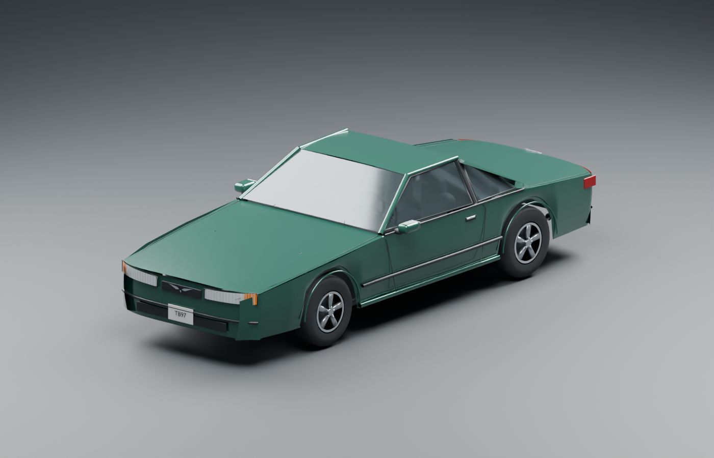
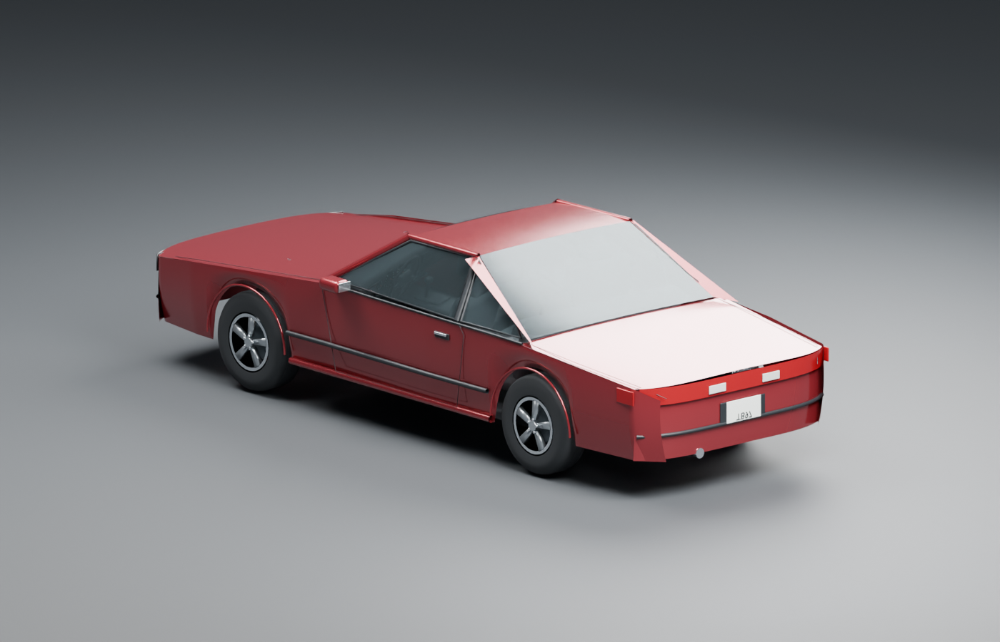

# 1997 Ford Thunderbird LX for BeamNG.drive

This is an original, low-detail experimental vehicle mod with a 3.8L V6 configuration and a 4.6L V8 configuration. Both use a four-speed automatic and rear-wheel drive.

The files target BeamNG.drive 0.40.x. RLS Career Overhaul 2.8.0 metadata and dealership filters have been checked against its published Lua source. **The vehicle has not been run in BeamNG. Driving, damage, purchasing, repairs, and save persistence remain unverified.**

## Model renders

These Blender renders show the prototype model. In-game appearance still needs verification.

## Download

Get the game ZIP and editable source from [GitHub Releases](https://github.com/JuanQuenga/beamng-1997-ford-thunderbird/releases). Both ZIPs are also in [dist](dist). Install `thunderbird_1997_prototype.zip` only. GitHub's automatic **Source code** ZIP contains the whole repository and is not an installable BeamNG mod.

The repository includes the Blender scene in [source](source), the generated game files in [build/vehicles/juan_tb97](build/vehicles/juan_tb97), the generators and validators in [tools](tools), and model renders in [renders](renders).

## Install and try the car

1. Close BeamNG.drive.
2. In the BeamNG launcher, select **Manage User Folder**, then **Open in Explorer**.
3. Open the `mods` folder in that user folder.
4. Copy `thunderbird_1997_prototype.zip` from this project's `dist` folder into `mods`. Leave the ZIP compressed.
5. Start BeamNG.drive and enable the mod in Mod Manager.
6. Open a Freeroam map and find **Ford Thunderbird LX [experimental]** in the vehicle selector.
7. Select either **3.8L Essex V6** or **4.6L SOHC Modular V8**.

Blender is not needed to install or play the mod. The source ZIP is for editing the vehicle.

## Try the car with RLS

1. Test both configurations in Freeroam first, using [the test guide](TESTING.md).
2. Use a separate test career or a backup copy of your RLS save for the first career test.
3. Enable the Thunderbird mod alongside RLS Career Overhaul.
4. Open the career marketplace after its normal stock refresh.
5. Check used-car sellers such as Quarryside Auto Sales.
6. Buy the car, store it, restart the game, and check that the car and installed engine return correctly.
7. Test repair quotes, a wheel replacement, and an engine swap in that test career.

The car can pass suitable dealer filters. Listings still depend on stock selection, seller policies, map, economy settings, and other mods. This package adds vehicle files only. It does not edit RLS, dealership definitions, or career saves.

The V6, V8, transmission, and four wheel assemblies have separate named slots and positive part prices. Both configuration files include year, type, drivetrain, power, weight, value, and population metadata.

## Prototype limits

- The body, cabin, five-spoke wheels, lights, and engine meshes are original approximations. They need further work for an accurate Thunderbird replica.
- The node-and-beam body is coarse. Doors, hood, trunk, and bumpers are not separate replaceable panels.
- Suspension geometry and spring rates need in-game testing and tuning. A linear constraint check does not prove stable driving.
- Engine curves are estimates constrained to nominal output. Masses and axle ratios are starting values, not measured vehicle data.
- Engine sounds reference generic built-in samples. Their presence and playback in the current game need verification.
- Engine thermals are disabled in this prototype. Overheating, cooling-system failure, and detailed engine wear are not implemented.
- Gauges, steering-wheel graphics, mirrors, and license-plate graphics are static. Use BeamNG's HUD for live instruments.
- Light lenses use glow materials. Projected headlight beams, breakable glass, opening panels, and occupants are not implemented.
- RLS parcel cargo, towing, Engine Works internals, and specialized job integrations are not implemented.

## Edit or rebuild

The editable scene is `source/thunderbird_1997.blend`. The model uses meters and BeamNG's coordinate convention: X left, Y rear, Z up.

The Python files regenerate the model, physics, configuration metadata, and packaging. See [BUILD.md](BUILD.md) for commands. See [SOURCES.md](SOURCES.md) for references and assumptions.

Anyone can view, fork, modify, and redistribute the original project files under the MIT license. To propose changes to this repository, see [CONTRIBUTING.md](CONTRIBUTING.md).

The original assets and scripts use the license in [LICENSE.txt](LICENSE.txt). Ford and Thunderbird names identify the depicted vehicle. This project is not an official Ford or BeamNG product.
